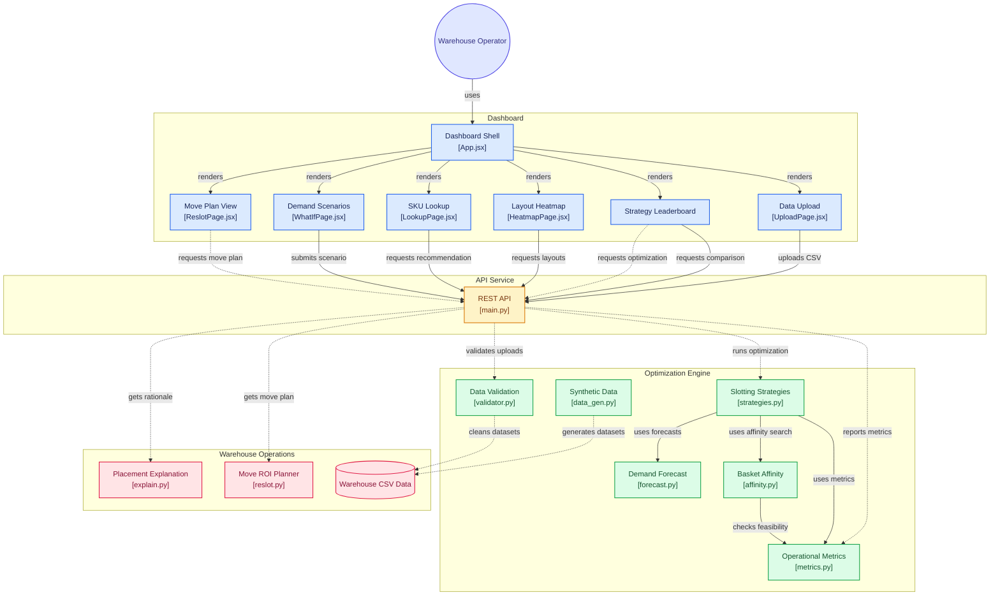

# SlotIQ — AI Warehouse Slotting Optimizer

SlotIQ is a high-performance, deterministic warehouse slotting optimization engine built for high-throughput distribution centers. It replaces haphazard storage allocations with mathematically optimal slot assignments using bipartite matching, Holt exponential smoothing demand forecasting, and market-basket co-purchase affinity search.

Runs on standard laptops without GPU or paid external APIs.

## System Overview



---

## Quickstart

In PowerShell, clone the repository and run the backend commands from its root. The repository root contains `api/`, `engine/`, `data/`, `tests/`, and `web/` directly.

Install [uv](https://docs.astral.sh/uv/getting-started/installation/) and Python 3.11 if they are not already available.

### Backend

```bash
git clone https://github.com/mithunaradya-ai/teammitras-solo.git
cd teammitras-solo
uv venv --python 3.11 .venv
uv pip install -r requirements.txt
.\.venv\Scripts\python.exe -m uvicorn api.main:app --reload
```

The API is available at `http://localhost:8000` and its interactive docs at `/docs`.

### Dashboard

In a second terminal, from the repository root:

```bash
cd web
npm.cmd install
npm.cmd run dev
```

Open `http://localhost:5173`. Node.js and npm are required for the dashboard.

## How It Works

1. On startup, the API loads the sample product, location, and order CSVs from `data/`.
2. The validation engine checks uploaded CSVs and updates the API's in-memory datasets.
3. The strategy engine matches products to feasible locations, scoring door travel from weekly demand and Manhattan distance. The forecast-and-affinity strategy adds a next-week demand estimate and attempts feasible swaps that trade off predicted door travel against co-order pair distance.
4. The React dashboard calls the API to show comparisons, layout maps, SKU explanations, demand scenarios, and suggested moves.

The app is a local prototype: it uses generated sample data by default, keeps uploaded data in memory, and does not connect to a warehouse system or execute inventory moves.

## Using the Prototype

Keep both terminals running while using the dashboard:

1. **Leaderboard:** compare the bundled baseline, greedy, Hungarian, and forecast-plus-affinity plans. The table reports picking distance, feasibility, space utilization, estimated INR labor cost, and average co-order pair distance. Use **Apply** to set a strategy as the API's active plan.
2. **Heatmap:** compare the baseline and optimized warehouse layouts.
3. **Product Lookup:** search for a SKU such as `P001` to see its recommended location and placement explanation.
4. **What-If Simulator:** adjust category demand multipliers or select a preset to recalculate an illustrative plan.
5. **Re-slotting Plan:** review the move list and illustrative cost/payback estimate; download the recommendations as CSV. This is a plan only—the prototype does not move inventory.
6. **Ingestion & Audit:** choose a data type, then upload its CSV to run the validator and inspect its audit summary. The bundled examples are `data/products_dirty.csv`, `data/locations_dirty.csv`, and `data/orders_dirty.csv`.

Uploaded data and the active plan are held in API memory, not persisted to a database. Restarting the API reloads the bundled sample datasets. Financial values and the synthetic benchmark are illustrative; use measured warehouse data and costs before making operational decisions.

### Tests and benchmarks

From the repository root:

```bash
.\.venv\Scripts\python.exe -m pytest tests -v
.\.venv\Scripts\python.exe -m engine.stress_benchmark
```

---

## System Architecture

```
.
├── engine/              # Pure Python deterministic optimization algorithms
│   ├── stress_benchmark.py # Tight-capacity greedy vs Hungarian benchmark
│   ├── data_gen.py      # Synthetic generator (seed 42, 300 SKUs, 320 bins, Pareto)
│   ├── validator.py     # Data cleaner & audit logging
│   ├── metrics.py       # 6 core warehouse operational metrics
│   ├── forecast.py      # Exponential smoothing (Holt 12-week lookahead)
│   ├── affinity.py      # Basket lift calculation & deterministic swap search
│   ├── strategies.py    # Baseline, ABC-Greedy, Hungarian, PuLP ILP, Forecast+Affinity
│   ├── explain.py       # Plain-English SKU placement audit generator
│   └── reslot.py        # Financial ROI & 1.3-day payback calculator
├── api/
│   └── main.py          # FastAPI REST endpoints (Upload, Optimize, Compare, Heatmap)
├── web/                 # React 19 + Vite + Tailwind + Plotly.js Dark Dashboard
├── data/                # Benchmark clean & dirty CSVs
├── tests/               # Constraint verification & reproducibility test suite
├── requirements.txt     # Python runtime, API, and test dependencies
├── README.md            # Setup guide & CLI instructions
└── REPORT.md            # Empirical performance report from real computed metrics
```

---

## Standalone CLI Verification Commands

Run from the repository root:

```bash
# Generate synthetic dataset (seed 42)
.\.venv\Scripts\python.exe engine/data_gen.py

# Run Data Validator on dirty dataset
.\.venv\Scripts\python.exe engine/validator.py

# Benchmark all 4 optimization strategies
.\.venv\Scripts\python.exe engine/strategies.py

# Run Explainability engine
.\.venv\Scripts\python.exe engine/explain.py

# Compute Re-slotting plan & payback ROI
.\.venv\Scripts\python.exe engine/reslot.py

# Run complete automated test suite
.\.venv\Scripts\python.exe -m pytest tests -v
```
