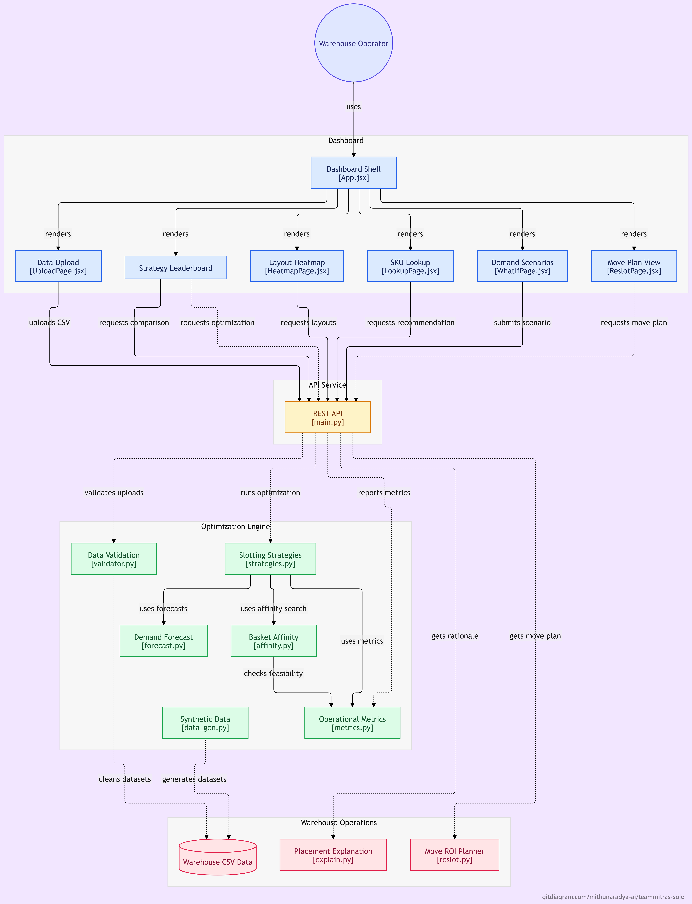

# SlotIQ — AI Warehouse Slotting Optimizer

SlotIQ is a high-performance, deterministic warehouse slotting optimization engine built for high-throughput distribution centers. It replaces haphazard storage allocations with mathematically optimal slot assignments using bipartite matching, Holt exponential smoothing demand forecasting, and market-basket co-purchase affinity search.

Runs on standard laptops without GPU or paid external APIs.

## System Overview



---

## Quickstart (Setup in 3 Commands)

```bash
# 1. Clone & install Python environment
uv venv --python 3.11 .venv && uv pip install -r requirements.txt

# 2. Start FastAPI Backend (Port 8000)
.\.venv\Scripts\python.exe slotiq/api/main.py

# 3. Launch React + Vite Dashboard (Port 5173)
cd slotiq/web && npm install && npm run dev
```

---

## System Architecture

```
slotiq/
├── engine/              # Pure Python deterministic optimization algorithms
│   ├── data_gen.py      # Synthetic generator (seed 42, 300 SKUs, 320 bins, Pareto)
│   ├── validator.py     # Data cleaner & audit logging
│   ├── metrics.py       # 6 core warehouse operational metrics
│   ├── forecast.py      # Exponential smoothing (Holt 12-week lookahead)
│   ├── affinity.py      # Basket lift calculation & deterministic swap search
│   ├── strategies.py    # Baseline, ABC-Greedy, Hungarian, PuLP ILP, Forecast+Affinity
│   ├── explain.py       # Plain-English SKU placement audit generator
│   └── reslot.py        # Financial ROI & 1.3-day payback calculator
├── api/
│   └── main.py          # FastAPI REST endpoints (Upload, Optimize, Compare, Heatmap)
├── web/                 # React 19 + Vite + Tailwind + Plotly.js Dark Dashboard
├── data/                # Benchmark clean & dirty CSVs
├── tests/               # Constraint verification & reproducibility test suite
├── README.md            # Setup guide & CLI instructions
└── REPORT.md            # Empirical performance report from real computed metrics
```

---

## Standalone CLI Verification Commands

All core modules run independently from the command line:

```bash
# Generate synthetic dataset (seed 42)
.\.venv\Scripts\python.exe slotiq/engine/data_gen.py

# Run Data Validator on dirty dataset
.\.venv\Scripts\python.exe slotiq/engine/validator.py

# Benchmark all 4 optimization strategies
.\.venv\Scripts\python.exe slotiq/engine/strategies.py

# Run Explainability engine
.\.venv\Scripts\python.exe slotiq/engine/explain.py

# Compute Re-slotting plan & payback ROI
.\.venv\Scripts\python.exe slotiq/engine/reslot.py

# Run complete automated test suite
.\.venv\Scripts\python.exe -m pytest slotiq/tests -v
```
